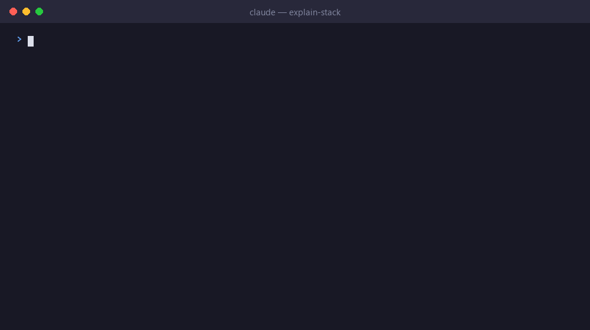

<p align="center">
  
</p>

<h1 align="center">explain-stack</h1>

<p align="center">
  <b>Finally understand <i>why</i> your project uses every technology in it, right in Claude Code.</b><br>
  <a href="https://github.com/Aleksa5000/explain-stack/stargazers"></a>
  <a href="LICENSE"></a>
  <a href="https://github.com/Aleksa5000/explain-stack/releases"></a>
</p>

<p align="center">
  
</p>

You built something, maybe with AI doing most of the typing. Now `package.json` has 40 packages and there's a `docker-compose.yml` with Redis in it. Why are they there? `explain-stack` reads your project and explains each technology in plain language, pointing at the exact files where it's used.

Made for vibe coders, beginners and anyone joining an unfamiliar codebase.

## ✨ What it does

- 🔍 **Finds your whole stack.** It reads manifests (`package.json`, `pyproject.toml`, `go.mod`, `Cargo.toml`…), Docker and CI files and database configs, then **greps the imports** to confirm what is actually used.
- 🧠 **Explains every technology in detail:**
  - **What it is**, in one sentence, and **an analogy** ("Redis is a sticky note on the fridge")
  - **Why it's here**, quoting your README/docs when they say why
  - **How it works in your code**: step by step, with real file and line references
  - **Key config**: the lines that set it up, and what each setting means
  - **Version notes** when the major version matters (e.g. Express 4 vs 5)
  - **Alternatives** and the trade-off, **what would break without it**, gotchas in your code, which file to open first, and the official docs
- 🗺️ **Understand the whole project, not just the packages:**
  - a **project map** (what each folder is for) and **how to run it** (commands, ports, what starts first)
  - **a request's journey**: one real action traced from the click to the database and back, file by file
  - the **data model** (tables and relations) and the **configuration** (env variable names and what they control, never values)
  - a **glossary** of every technical term used
- 🗺️ **Draws how the pieces connect**: an ASCII diagram in chat and a Mermaid diagram in the file.
- 🕵️ **Honest findings**: unused packages, duplicate libraries, services set up but never called, missing tests. It reports them and **never changes anything**.
- ❓ **A 3-question quiz** about *your* project, to check that it clicked. You can skip it.
- 📄 **Saves `STACK.md`**. If you already have one, it asks before overwriting.
- 🎯 **Deep dive mode**: `/explain-stack redis` goes deep on one technology: how your code uses it, core concepts, common mistakes, interview questions and a 30-minute exercise. If the technology isn't in the project, it says so instead of inventing usage.
- 🧩 **Code walkthrough mode**: `/explain-stack code` finds the 3–5 most important pieces of your code (core logic and algorithms like scheduling, ranking, retries or parsing) and explains them **line by line**: what each key line does and why, the algorithm's name, an example run with real values, its speed (Big-O) and edge cases, plus how to explain it in an interview. Point it at one file with `/explain-stack code src/scheduler.py`. It can save the walkthrough to `CODE.md`.
- 🔎 **Changes mode**: `/explain-stack changes` explains what just changed in your code, perfect after an AI agent edited 10 files. It reads your uncommitted changes (or the last commit, the last N commits or a branch), groups them by feature, explains **what changed and why**, flags risks (removed validation, deleted tests, hard-coded secrets, destructive migrations) and leftovers (`console.log`, unused imports), and tells you **how to test it**. It never stages, commits or reverts anything.
- 🌍 **Speaks your language**, at your level (beginner by default; say "I'm intermediate" for more depth).

## 📦 Install

**Option A: as a plugin (recommended, gets updates)**

Inside Claude Code:
```
/plugin marketplace add Aleksa5000/explain-stack
/plugin install explain-stack@explain-stack
```

**Option B: copy the skill manually**
```bash
git clone https://github.com/Aleksa5000/explain-stack.git
# macOS / Linux
cp -r explain-stack/skills/explain-stack ~/.claude/skills/
# Windows (PowerShell)
Copy-Item -Recurse explain-stack\skills\explain-stack $HOME\.claude\skills\
```

Restart Claude Code after installing.

**Option C: Codex** (it reads the same `SKILL.md` format)
```
codex plugin marketplace add Aleksa5000/explain-stack
codex plugin add explain-stack@explain-stack
```
Or copy the folder: `cp -r explain-stack/skills/explain-stack ~/.agents/skills/`. In Codex, run it with `$explain-stack` instead of `/explain-stack`.

## 🔄 Stay up to date

New versions come out often. Turn on automatic updates once, and you'll always have the latest:

**Claude Code** (third-party plugins don't auto-update by default):
- In Claude Code: `/plugin` → **Marketplaces** → **explain-stack** → **Enable auto-update**
- Or add `"autoUpdate": true` to the marketplace in `~/.claude/settings.json`:
  ```json
  "extraKnownMarketplaces": {
    "explain-stack": { "source": { "source": "github", "repo": "Aleksa5000/explain-stack" }, "autoUpdate": true }
  }
  ```
Claude Code then checks for updates in the background and installs them; run `/reload-plugins` or restart to use the new version. To update right away: `claude plugin marketplace update explain-stack` and `claude plugin update explain-stack@explain-stack`.

**Codex** (no automatic plugin updates yet): `codex plugin marketplace upgrade explain-stack`

**Manual copy:** `git pull` in your clone and copy `skills/explain-stack` again.

## 🚀 Usage

Open Claude Code in your project folder and run:

| Command | What you get |
|---|---|
| `/explain-stack` | The whole project explained in detail: map, how to run it, every technology, a traced request, data model, configuration, findings, glossary, quiz, `STACK.md` |
| `/explain-stack quick` | A short overview (the old, compact cards) |
| `/explain-stack redis` | A deep dive on one technology |
| `/explain-stack code` | The most important code and algorithms, line by line |
| `/explain-stack code src/auth.ts` | One file or function, line by line |
| `/explain-stack changes` | What just changed (uncommitted, or the last commit) and how to test it |
| `/explain-stack changes 3` | The last 3 commits explained |

When installed as a plugin, the full name is `/explain-stack:explain-stack`. You can also just ask *"why does this project use Redis?"*, *"explain how this algorithm works"*, *"what did the AI just change?"* or *"explain my stack, I'm a beginner"*.

See a real output in [`examples/sample-STACK.md`](examples/sample-STACK.md), generated from a small Express + Zod + SQLite API.

## 🔒 Safe by design

- **Read-only.** It scans your project with Read/Glob/Grep and read-only `git log/status/diff/show`. No other shell commands, no installs, no builds, never `git add/commit/reset`.
- **Never reads secrets.** It skips `.env*` files (except `.env.example`), keys, credentials and databases, and excludes them from searches and diffs. We tested this with a planted fake secret.
- **Never changes your code.** `STACK.md` (and `CODE.md`, if you agree) are the only files it writes. If you ask it to fix something (e.g. remove an unused package or revert a change), it first finishes the explanation, lists exactly what it would change and waits for your explicit yes.

## 💬 Feedback

At the end, the skill shows a **prefilled feedback link** once. It contains only the mode, level, language and number of technologies. **Nothing is sent automatically.**
- [Give feedback](https://github.com/Aleksa5000/explain-stack/issues/new?template=feedback.yml)
- [Report a bug](https://github.com/Aleksa5000/explain-stack/issues/new?template=bug_report.yml)
- [Suggest an idea](https://github.com/Aleksa5000/explain-stack/issues/new?template=feature_request.yml)
- [Discussions](https://github.com/Aleksa5000/explain-stack/discussions)

## 🤝 Works great with

**[mock-interview](https://github.com/Aleksa5000/mock-interview)**. First understand your stack with `/explain-stack`, then practice explaining it to an interviewer with `/mock-interview`.

## Contributing

Ideas, new ecosystems, better analogies and translations are welcome.
The skill lives in [`skills/explain-stack/`](skills/explain-stack/):
- `SKILL.md` is the main flow
- `references/` holds stack detection, the explanation guide and the `STACK.md` template

Release checklist: bump the version in `.claude-plugin/plugin.json`, in the feedback link in `SKILL.md` (Phase 5), and in `CHANGELOG.md`. The icon is rendered from `docs/logo.svg`, and the demo GIF is made by `scripts/make_demo_gif.py`.

If this helped you understand your project, please ⭐ the repo so more people can find it.

## License

[MIT](LICENSE) © Aleksa Djorovic
