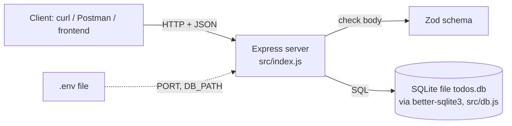

# Tech stack: todo-api

> `todo-api` is a small REST API for a todo list. It has no website or user interface. Other programs (a frontend, a mobile app, or a tool like `curl`/Postman) send it HTTP requests. It has two endpoints: `GET /todos` lists all todos and `POST /todos` creates one. It runs on **Node.js**, uses **Express** to handle requests, **Zod** to check the incoming data, and **SQLite** (through `better-sqlite3`) to store todos in a single file on disk.

## How it fits together

**One request, step by step:** a client sends `POST /todos` with `{"title": "Buy milk"}`. Express receives it and turns the JSON body into a JavaScript object (`express.json()`, `src/index.js:7`). Zod checks that `title` is a non-empty string and fills in `done: false` (`src/index.js:9`, `src/index.js:13`). If the check fails, the client gets a `400` error. If it passes, `better-sqlite3` runs an `INSERT` into the `todos` table (`src/index.js:15`) and Express sends back the new todo with status `201`.

## Technologies

### Backend / API

#### Node.js · runtime
**What it is:** The program that runs JavaScript outside the browser, on a server or your computer.
**Analogy:** The building the kitchen is in. Without it, nothing can be cooked.
**Why it's here:** Everything in `src/` is JavaScript run by Node. `package.json:5` starts the server with `node --watch src/index.js`, which restarts it every time you save a file. `"type": "module"` (`package.json:4`) means the code uses modern `import` syntax instead of the older `require`.
**Instead you could use:** Bun, Deno, or a different language entirely (Python, Go) · **Why this one (likely):** it's the most common way to run JavaScript on a server, with the biggest ecosystem of packages.
**Without it:** Nothing runs.

#### Express 4 · backend framework
**What it is:** A small library for building web servers: it listens for HTTP requests and lets you say "when someone asks for this URL, run this function".
**Analogy:** The kitchen. It takes orders (requests), hands them to the right cook (route handler), and sends the dish out (response).
**Why it's here:** `src/index.js:6` creates the app, `:11` defines `GET /todos`, `:12` defines `POST /todos`, and `:19` starts listening on a port.
**Instead you could use:** Fastify, Hono, Koa · **Why this one (likely):** Express is the oldest and best-known Node framework. There are tutorials for everything and AI tools default to it. Fastify is faster and Hono is more modern, but for a small API the difference doesn't matter.
**Without it:** You'd use Node's built-in `http` module and write URL matching, JSON parsing and status codes yourself.

#### Zod 3 · validation
**What it is:** A library to describe what data *should* look like and check real data against that description.
**Analogy:** A bouncer at the door who checks every guest's ID before letting them in.
**Why it's here:** `src/index.js:9` says a todo must have a `title` (string, at least 1 character) and an optional `done` (boolean, default `false`). `src/index.js:13` checks the request body with `safeParse`, and `:14` returns a `400` error with the details if it's wrong.
**Instead you could use:** Joi, Yup, Valibot, or manual `if` checks · **Why this one (likely):** Zod is very popular right now, has a short syntax and works great with TypeScript (if you add it later).
**Without it:** Anyone could send `{"title": 123}` or an empty body, and that bad data would go straight into your database.

### Data

#### SQLite via better-sqlite3 11 · database
**What it is:** SQLite is a full SQL database that lives in **one file** (`todos.db`), with no separate database server. `better-sqlite3` is the Node library that lets your code talk to it.
**Analogy:** A warehouse with labeled shelves, small enough to fit in one box you can carry around.
**Why it's here:** `src/db.js:2` opens (or creates) the database file. `src/db.js:3` creates the `todos` table if it doesn't exist yet. `src/index.js:11` reads all todos with `SELECT`, and `:15` saves a new one with `INSERT`. The `?` placeholders in `:15` safely insert user values, which protects you from SQL injection.
**Instead you could use:** PostgreSQL or MySQL (separate server, better for many users at once), a JSON file, or MongoDB · **Why this one (likely):** zero setup: no server to install, no password, no Docker. Perfect for a small project. `better-sqlite3` is chosen over other SQLite libraries because it's simple and synchronous (no `await` needed).
**Without it:** Todos would only live in memory and disappear every time the server restarts.

### Developer tools

- **Vitest 2** (`package.json:7`): a test runner, started with `npm test` (`package.json:5`). It's installed, but there are **no test files yet** (see Findings).
- **`node --watch`** (`package.json:5`): built into Node (no extra package); restarts the server when you change code.

### Small helpers

- **`dotenv`**: reads a `.env` file and puts its values into `process.env` (`src/index.js:1`). This is how `PORT` (`src/index.js:19`) and `DB_PATH` (`src/db.js:2`) get set without writing them in the code. `.env.example` shows which variables exist.
- **`lodash`**: a collection of utility functions (sorting, grouping, deep copying…). Installed but **not used** anywhere (see Findings).

## Findings

These are learning points, not mistakes you must fix right now.

- **`lodash` looks unused.** It's in `package.json:6`, but no file imports it. It could be removed, or it may have been added "just in case" by a template or AI.
- **Vitest is installed but there are no tests.** `npm test` has nothing to run. A good first test would be: "POST /todos with an empty title returns 400".
- **`API_SECRET` is in `.env.example` but never read by the code.** The name suggests someone planned to protect the API with a secret key, but right now **anyone who can reach the server can read and create todos**.
- **No lock file** (`package-lock.json` / `pnpm-lock.yaml`) in the folder. Without it, two people running `install` may get slightly different versions of the packages.
- **No `.gitignore`.** If you put this in git, make sure `.env` and `todos.db` are ignored, so secrets and local data don't get committed.
- **Newer major versions exist** for Express (5) and Zod (4). Versions 4 and 3 still work fine. Upgrading a major version can require small code changes, so read the migration guide first.
- **Only "list" and "create".** There's no way to update (`PUT`/`PATCH`) or delete (`DELETE`) a todo yet. That's normal for an early version.

## Remember these 3 things

1. **Express receives the request, Zod checks it, SQLite stores it.** That's the whole flow, and it all happens in `src/index.js` + `src/db.js`.
2. **The database is just a file** (`todos.db`). Delete the file and all todos are gone. Copy the file and you have a backup.
3. **Settings come from environment variables** (`PORT`, `DB_PATH`) via `dotenv`, so the same code can run on your laptop and on a server with different settings.

## Learn next

- Add a `DELETE /todos/:id` route yourself, then write one Vitest test for it. That one exercise touches Express routing, SQL, and testing.
- Practice explaining it: [`/mock-interview`](https://github.com/Aleksa5000/mock-interview)

---
*Generated by [explain-stack](https://github.com/Aleksa5000/explain-stack) on 2026-11-13. Explanations are based on the code at that time.*
