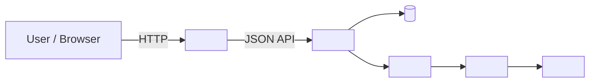

# STACK.md template

Write in the user's language. Fill every `<…>`; drop empty sections.

````markdown
# Tech stack: <project name>

> <One-paragraph big picture: what the project does and its main parts.>

## How it fits together



<2–4 sentences walking through one typical request through the diagram.>

## Technologies

### Frontend / UI
<cards from explanation-guide.md>

### Backend / API
<cards>

### Data
<cards>

### Background & real-time
<cards>

### External services & AI
<cards>

### Developer tools
<cards or one-line list>

### Infrastructure
<cards>

### Small helpers
- `<lib>`: <one line>

## Findings
- <possibly unused / duplicates / outdated / heavier than needed, with file evidence>

## Remember these 3 things
1. <…>
2. <…>
3. <…>

## Quiz
1. <question>: **Answer:** <…>
2. <question>: **Answer:** <…>
3. <question>: **Answer:** <…>

## Learn next
- <concrete next step or mini project>
- Practice explaining it: [`/mock-interview`](https://github.com/Aleksa5000/mock-interview)

---
*Generated by [explain-stack](https://github.com/Aleksa5000/explain-stack) on <YYYY-MM-DD>. Explanations are based on the code at that time.*
````
