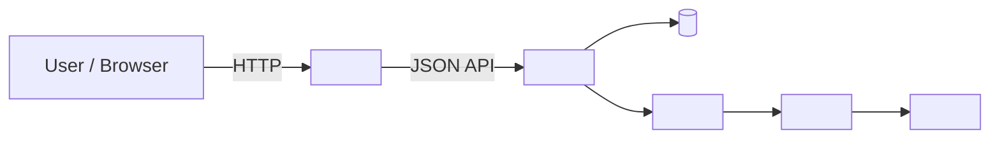

# STACK.md template

Write in the user's language. Fill every `<…>`; drop empty sections. In quick mode, drop the sections marked *(detailed)*.

````markdown
# Tech stack: <project name>

> <One-paragraph big picture: what the project does, who it's for, and its main parts.>

## Contents
[How it fits together](#how-it-fits-together) · [Project map](#project-map) · [How to run it](#how-to-run-it) · [Technologies](#technologies) · [A request's journey](#a-requests-journey) · [Data model](#data-model) · [Configuration](#configuration) · [Findings](#findings) · [Key code](#key-code) · [Glossary](#glossary)

## How it fits together



<2–4 sentences walking through one typical request through the diagram.>

## Project map *(detailed)*

```
<folder>/        <one line>
  <subfolder>/   <one line>
```

## How to run it *(detailed)*

| Part | Command | Port | Needs first |
|---|---|---|---|
| <Backend> | `<command from scripts/README>` | <8000> | <Postgres running> |

## Technologies

### Frontend / UI
<cards from explanation-guide.md>

### Backend / API
<cards>

### Data
<cards>

### Background & real-time
<cards>

### External services & AI
<cards>

### Developer tools
<cards or one-line list>

### Infrastructure
<cards>

### Small helpers
- `<lib>`: <one line>

## A request's journey *(detailed)*

**<The main action, e.g. "A student answers a quiz question">**
1. `<file:line>`: <what happens>
2. …

## Data model *(detailed)*

| Entity | Important fields | Relations | Defined in |
|---|---|---|---|
| <User> | <email, password_hash> | <has many Attempts> | `<file>` |

## Configuration *(detailed)*

| Variable | What it controls | Default | Read in |
|---|---|---|---|
| `<NAME>` | <…> | <…> | `<file:line>` |

*(Names only. Values live in your `.env`, which is never read or copied here.)*

## Findings
- <possibly unused / missing from manifest / duplicates / outdated / fragile spots, with `file:line`>

## Key code
- `<path:lines>`: <one line>. Walk through it with `/explain-stack code`.

## Remember these 3 things
1. <…>
2. <…>
3. <…>

## Quiz
1. <question>: **Answer:** <…>
2. <question>: **Answer:** <…>
3. <question>: **Answer:** <…>

## Glossary *(detailed)*
- **<term>**: <one plain sentence>

## Learn next
- <concrete next step or mini project>
- Practice explaining it: [`/mock-interview`](https://github.com/Aleksa5000/mock-interview)

---
*Generated by [explain-stack](https://github.com/Aleksa5000/explain-stack) on <YYYY-MM-DD>. Explanations are based on the code at that time.*
````
